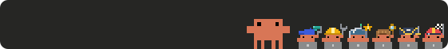
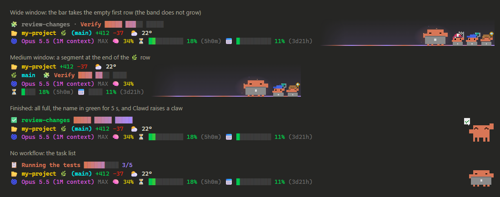

# Clawd Pet for Claude Code

**English** · [Português (Brasil)](README.pt-BR.md)

<p align="center"></p>

<p align="center"><sub>example with made-up data</sub></p>

**Version:** 0.4.0 · see the [CHANGELOG](CHANGELOG.md).

**Clawd**, the little orange Claude Code crab, living animated in the band right above the
message box, in the desktop app and in the terminal. In the desktop app he sits next to a
**statusline** that updates itself (folder, model, context, usage limits and the weather
where you are).

He reacts to what is going on: he grabs the laptop when you send a message, puts on glasses
when Claude reads files, sweats when the context fills up, opens an umbrella when it rains in
your city, sets off fireworks on `git commit`... The full list is in the [sheet](#the-sheet-what-each-animation-means).
Each subagent gets a mini-Clawd dressed for its task, and a [progress bar](#progress-bar)
follows your workflows.

> **Unofficial fan project.** It is not made, endorsed or supported by Anthropic. "Claude",
> "Claude Code" and Clawd belong to Anthropic. The pixel drawings and the laptop animation in
> this repository were made for him.

## Where it runs

| Surface | Tested on | What you get |
|---|---|---|
| Desktop app (Code tab) | Windows 11, app 2.1.288 and 2.1.293 | Clawd + the statusline + the progress bar, with taps |
| Terminal (`claude`) | Linux (Omarchy, Ghostty), Claude Code 2.1.309 | Clawd, drawn with colored half blocks (see [In the terminal](#in-the-terminal)) |
| macOS, and the other combinations | not tested yet | should work: paths are portable (`~/.claude`) |

If you try it somewhere not listed, please [open an issue](https://github.com/gusthanks/clawd-pet-statusline/issues)
telling whether it worked, with your system, surface and Claude Code version.

---

## Install

**You need:**
- Claude Code with **mod support**: the desktop app (Code tab) or the terminal `claude`, in a
  version that loads mods from `CLAUDE_CODE_PLUGIN_DIRS` (the versions in the table above do).
  A mod is a folder of function hooks that Claude Code loads at startup and that can draw in the
  band above the prompt; it is not installed from a marketplace, just pointed to by that variable.
- [Node.js](https://nodejs.org) 18 or newer (for the installer and the statusline).

```bash
git clone https://github.com/gusthanks/clawd-pet-statusline.git
cd clawd-pet-statusline
node install.mjs
```

Then **open a new conversation**. Conversations that were already open stay as they were.

The installer:
1. copies the `clawd/` folder to `~/.claude/mods/clawd` (a previous version becomes `.bak-<date>`);
2. copies the statusline to `~/.claude/statusline-rgb.js`, if you don't have one there yet;
3. backs up your `~/.claude/settings.json` and adds one line:

```json
"env": { "CLAUDE_CODE_PLUGIN_DIRS": "~/.claude/mods/clawd" }
```

The `settings.json` lives in `.claude` inside your user folder: `~/.claude/settings.json` on
macOS and Linux, `C:\Users\<you>\.claude\settings.json` on Windows. The installer writes the
full path of your own machine there (on Windows, something like `C:/Users/<you>/.claude/mods/clawd`).
Its messages are in English, or in Portuguese when your locale (`LC_ALL`, `LC_MESSAGES` or
`LANG`) starts with `pt`.

**To turn it off:** `node install.mjs --uninstall` (removes only that line; the files stay).

**To update:** `git pull` and run `node install.mjs` again.

---

## The sheet: what each animation means

The images below are generated straight from the code (`tools/make-sheet.py`), so they are
exactly what you see in the app.

### Everyday

| | What you see | When it happens |
|---|---|---|
|  | **Strolling** | Nothing going on: he walks along the track and looks around. |
|  | **Message in** | You sent a message: he waves, runs to the corner, grabs the laptop and opens it. |
|  | **Celebrating** | The reply finished fine: he puts the laptop away and jumps with confetti. |
|  | **Startled** | The turn ended with an error. |
|  | **Sleeping** | 10 idle minutes (3 at night). A tap wakes him up. |

### Working (the accessory shows what Claude is doing)

| | What you see | When it happens |
|---|---|---|
|  | **Glasses** | Reading files (Read, Grep, Glob). |
|  | **Magnifier** | Searching the web (WebSearch, WebFetch, browser). |
|  | **Little hammer** | Editing files (Edit, Write). |
|  | **Mini-Clawds** | One per running subagent, each on its own laptop (up to 6; then a "+N" shows up). Each one dresses for its task, read from the task's name (English and Portuguese words), the agent type or its first tool. When it finishes fine, it raises a claw, its hat flies off, and it leaves the bay. |
|  | **Costumes** | Racer with a checkered flag (verify, review, test), pirate with a sword (refute, critique), detective with a magnifier (research, map; `Explore` agents), astronaut (plan, spec; `Plan` agents), engineer with a wrench (implement, fix), painter with a roller (design, visual). Two more: chef with a frying pan (write, docs) and judge with a gavel (judge, decide). No clue in the name: the plain mini-Clawd. |
|  | **Purple aura + light streak** | Ultracode mode, or a workflow running in the background. In the terminal, two blinking sparks take their place. |
|  | **Press** | Claude is compacting the conversation context. |
|  | **Fireworks** | Right after a successful `git commit` or `git push`. |
|  | **Tests passed** | A test command (`npm test`, `pytest`, `go test`, `cargo test`, `claude plugin test`...) finished fine: he puts the laptop away and raises a claw with a green "✓" for 3 seconds. If the tests fail, he gets the *Startled* scene instead. |

### Warnings (he reads the statusline)

| | What you see | When it happens |
|---|---|---|
|  | **Sweating** | The context is above 80%. |
|  | **Worried** (eyebrows + "!" bubble) | The 5-hour limit is above 90%. |
|  | **"pausa?"** (break?) | One hour of non-stop work: he stretches and suggests a break. |
|  | **Calling you** (waving + "?" bubble) | Claude is waiting for your permission: he puts the laptop away and waves until the approved tool finishes (or 10 minutes pass). Claude Code gives no "answered" signal, so after you approve, a long command keeps him waving until it ends. |

### Time and weather

| | What you see | When it happens |
|---|---|---|
|  | **Coffee** | From 6am to 11am, idle. |
|  | **Small hours** | From midnight to 5am: he yawns and falls asleep sooner, and the lane gets a small crescent moon and a few twinkling stars (the stars go away if it's raining, the moon stays). |
|  | **Umbrella** | It is raining where you are: he wears the umbrella on his head and the track gets rain. |
|  | **Big umbrella** | Raining and working: it covers him and the laptop. Each mini-Clawd gets a small umbrella of its own, stuck on its head, covering it and its little laptop. |
|  | **Dates** | A red Christmas hat on Dec 24 and 25; a colorful party hat with light confetti on Dec 31, Jan 1 and on your birthday (set it with `CLAWD_BIRTHDAY`). When it rains the umbrella wins and the hat goes away. |

### Playing with him (desktop app)

| | What you see | When it happens |
|---|---|---|
|  | **Tap** | Click him: he flattens and pops out a star. |
|  | **Dizzy** | Four taps in 3 seconds: spinning eyes and little stars. |

---

## The statusline (desktop app)

In the same band, to the left of Clawd:

- 📂 the conversation's folder, with lines changed (`+12 -3`) and the current weather (☁️ 22°);
- 🌀 the model, the effort (MEDIUM, HIGH, MAX...) and how much of the context is used;
- ⏳ and 📅 the 5-hour and 7-day usage limits, with the time until they renew.

It updates itself: every 20 seconds, and the moment something changes. The text comes from
`~/.claude/statusline-rgb.js` (a plain Node script with no dependencies, also usable as a regular
Claude Code `statusLine` command in the terminal), and the limits come straight from your
account, like the usage panel in the app (see [Privacy](#privacy-who-the-mod-talks-to)).

If the band is narrow, the statusline switches to a compact format. To force the compact format
always, create the empty file `~/.claude/statusline-narrow`, or set `CLAUDE_STATUSLINE_COLS`
to a small width (for example `export CLAUDE_STATUSLINE_COLS=45` in bash/zsh, or
`setx CLAUDE_STATUSLINE_COLS 45` on Windows) before starting Claude Code.

On Windows the weather place follows you: it is read from the Windows location service
(Settings > Privacy & security > Location must be on), and the IP lookup, which can land
kilometers away in the middle of the city, is only the backup.

### Progress bar

<p align="center"></p>

<p align="center"><sub>example with made-up data</sub></p>

While Claude works on something long, a bar shows how far along it is. Nobody has to report
progress: the mod reads it from what Claude Code already does.

- 🧩 **A workflow:** one block segment per phase, with the name of the phase running now.
  Each phase fills as its agents finish, and the bar never goes back.
- 📋 **The task list**, when there is no workflow: the task in progress and how many are done.
- 🤖 **A batch of helpers**, when there is neither: how many finished.

The band never grows for it. On a wide window the bar takes the empty first row; otherwise it
becomes a segment at the end of a row, and shrinks (down to `🧩 2/3`) when space is short.
When a workflow finishes, the bar fills up with ✅ for 5 seconds and Clawd raises a claw;
if it fails or is stopped, ❌ freezes the bar for 8 seconds and Clawd gets startled.

---

## In the terminal

New in 0.4.0. In the terminal `claude`, Clawd is animated too: the same lane as the app, drawn
with colored half blocks (`▀▄█`) in a 7-row band above the prompt, about 12 frames a second.
Every scene is there (laptop, party, rain, mini-Clawds in costumes, fireworks...); the ultracode
aura becomes two blinking sparks, since a soft gradient turns into a solid blob in half blocks.

What is different from the desktop app:
- **No statusline or progress bar in the band**: the terminal already has its own statusline
  below the prompt. You can point it at the same script with
  `"statusLine": { "type": "command", "command": "node ~/.claude/statusline-rgb.js" }` in settings.json.
- **No taps**: the terminal band does not take clicks.
- A band shorter than 6 rows or narrower than 24 columns falls back to the orange block logo.
- Collapse the band with ctrl+x ctrl+a. In non-interactive runs (`claude -p`) he stays still and costs nothing.

How it works: `raster.ts` reads the lane's SVG (the same one the desktop draws, animations
included) and paints it frame by frame into a grid of cells, repainted in place about 12 times a
second without redrawing the band. To look at the terminal frames without Claude Code, run
`node tools/term-preview.ts` (it writes PNGs; needs Node 22.6+ and ImageMagick).

---

## Optional tweaks (variables in the `env` of settings.json)

| Variable | What it does |
|---|---|
| `CLAWD_LOCATION` | Pins the weather location, for example `"-23.55,-46.63"`. Without it, on Windows the place comes from the Windows location service, and otherwise (or if that is off or denied) from your internet connection. |
| `CLAWD_BIRTHDAY` | Your birthday as `"DD-MM"`, for example `"06-10"`: on that day Clawd wears the party hat. Nothing is sent anywhere; it only compares with the local date. |
| `CLAWD_STATUSLINE` | Uses another statusline script instead of `~/.claude/statusline-rgb.js`. |
| `CLAWD_NODE` | Full path of the Node executable that runs the statusline, e.g. `"C:/Program Files/nodejs/node.exe"`. Without it, the mod tries `node` from the PATH, then (on Windows) whatever `where node` finds, then the usual Mac/Linux paths. |
| `CLAWD_DEBUG` | Any value turns it on: saves a log of your clicks in `~/.claude/plugins/store/clawd_inline-*.json`, to help report problems. |
| `CLAWD_WEATHER` | `off` (or `0`, `false`) turns the weather off: no location lookup (Windows or IP) and no Open-Meteo request. The statusline shows no weather, and Clawd never opens the umbrella or makes it rain on the lane. The local time and date (night sky, morning coffee, hats, birthday) then come from your system clock and time zone instead of Open-Meteo's. |
| `CLAWD_LIMITS` | `off` (or `0`, `false`) turns off the api.anthropic.com request. The statusline keeps only what Claude Code itself reports with each reply, and Clawd does not get "worried" about the limit. |
| `CLAUDE_STATUSLINE_COLS` | Width the statusline script lays out for; below 60 it uses the compact format. |

The mod's screen-reader text (the `alt` of the lane) is in English, or in Portuguese when
`LC_ALL`, `LC_MESSAGES` or `LANG` starts with `pt`. Windows usually sets none of these; for the
Portuguese text there, add `"LANG": "pt_BR.UTF-8"` to the `env` of settings.json.

---

## Privacy: who the mod talks to

| Service | What is sent | What for | How often | How to turn off |
|---|---|---|---|---|
| Windows location service | nothing: the position is read locally, nothing leaves the machine | finding where you are, for the weather (Windows only) | once an hour | `CLAWD_WEATHER=off` (or pin the place with `CLAWD_LOCATION`); if denied, or not on Windows, the IP is used |
| [get.geojs.io](https://www.geojs.io) (backup: [ipwho.is](https://ipwho.is)) | your IP (sent automatically with any request) | finding your city, for the weather, only as a backup (Windows location denied, off, or not on Windows) | once an hour | `CLAWD_WEATHER=off` (or pin the place with `CLAWD_LOCATION`) |
| [Open-Meteo](https://open-meteo.com) | rounded latitude and longitude | the weather and the time zone | every 15 min | `CLAWD_WEATHER=off` |
| api.anthropic.com | your own Claude login (attached by Claude Code, see below) | the usage limits in the statusline | every 2 min | `CLAWD_LIMITS=off` |

**About the usage limits.** They come from `https://api.anthropic.com/api/oauth/usage`, the
endpoint Claude Code's own `/usage` reads. It is **not a documented public API**: it can change
or disappear without notice, and then the limits simply stop showing (an error never breaks the
band). The mod never sees, reads or stores your token: it asks Claude Code for an authorization
handle (`$.session.authorize()`), and Claude Code attaches the login to that one request, which
only goes to api.anthropic.com. If you would rather not use it, set `CLAWD_LIMITS=off`.

Nothing else leaves your machine, and nothing is stored outside it. With `CLAWD_LOCATION`,
neither the Windows lookup nor the IP lookup happens. To keep the mod off the internet entirely, put
`CLAWD_WEATHER=off` and `CLAWD_LIMITS=off` in the `env` of settings.json.

The costumes and the progress bar talk to no one: they only read what Claude Code itself
writes on your machine (each subagent's task name, and a workflow's script and run files
under `~/.claude/projects`).

---

## For tinkerers

```
clawd/                     the mod (a function-hooks plugin)
  hooks/register.tsx       the main module: the hooks, the state and everything that uses $
  hooks/scenes.ts          the scenes: what he does in each mood, step by step
  hooks/lane.ts            the lane SVG: sizes, animation tracks and the final drawing
  hooks/statusline.ts      the terminal colors (ANSI) and the model name
  hooks/raster.ts          the lane in the terminal: the SVG read and painted into cells, frame by frame
  hooks/limits.ts          the usage-limits request: address, pace, parsing
  hooks/weather.ts         the weather: addresses and the weather code as an emoji
  hooks/git.ts             lines changed and commit/push detection
  hooks/tap-reaction.ts    the tap: where a click lands and the reaction scene
  hooks/costumes.ts        the mini-Clawds' costumes and who wears which, by task name
  hooks/team.ts            the mini-Clawds' bay: each mini in costume and the party of those who finish
  hooks/progress.ts        the progress bar: phases, fill and where it fits
  hooks/art.ts             the SVG drawings (body, eyes, accessories, effects)
  hooks/laptop.ts          the laptop frames (generated by tools/laptop.py)
  hooks/tap.tsx            the invisible area that receives taps
  hooks/clawd.test.tsx     the tests
statusline/                the statusline (Node, no dependencies)
tools/laptop.py            draws the laptop and generates laptop.ts (--preview writes a PNG)
tools/make-sheet.py        generates the animations in docs/sheet/
tools/term-preview.ts      renders the terminal frames to PNG, outside Claude Code
```

```bash
cd clawd/..                         # the folder that contains clawd/
claude plugin validate ./clawd      # checks the mod
claude plugin test ./clawd          # runs the tests
python tools/make-sheet.py          # rebuilds the sheet
node tools/term-preview.ts          # previews the terminal frames
```

Code comments are still mostly in Portuguese and are being translated bit by bit. Issues and
pull requests in English are preferred; Portuguese is welcome too.

License: [MIT](LICENSE).
