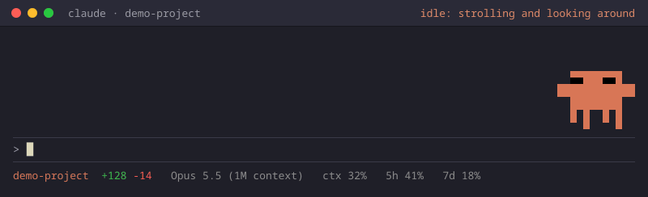
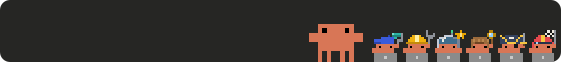
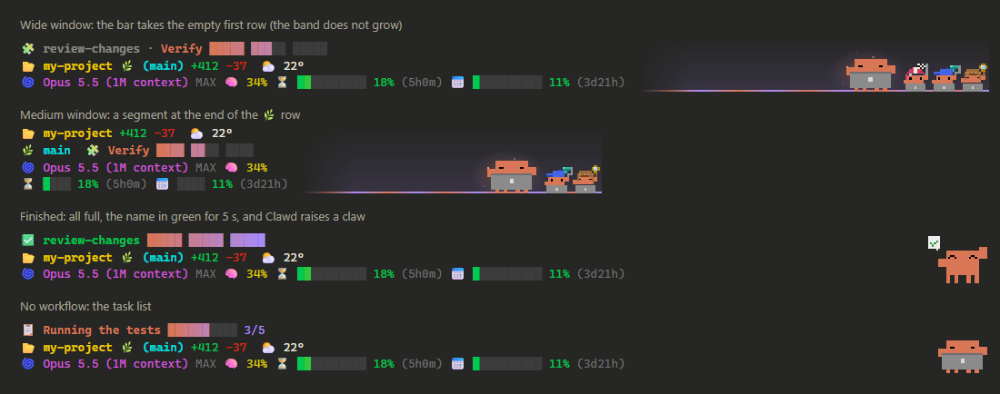

# Clawd Pet para o Claude Code

[English](README.md) · **Português (Brasil)**

<p align="center"></p>

<p align="center"><sub>exemplo com dados inventados</sub></p>

<p align="center"></p>

<p align="center"><sub>o mesmo no terminal (novidade da 0.4.0), gerado a partir dos quadros reais do terminal</sub></p>

**Versão:** 0.4.0 · veja o [CHANGELOG](CHANGELOG.md) (em inglês).

O **Clawd**, o caranguejinho laranja do Claude Code, morando animado na faixa logo acima da
caixa de mensagem, no app do desktop e no terminal. No app do desktop ele fica ao lado de uma
**statusline** que se atualiza sozinha (pasta, modelo, contexto, limites de uso e o clima de
onde você está).

Ele reage ao que está acontecendo: pega o laptop quando você manda mensagem, põe óculos
quando o Claude lê arquivos, sua quando o contexto enche, abre o guarda-chuva quando chove
na sua cidade, solta fogos no `git commit`... A lista completa está na [sheet](#a-sheet-o-que-cada-animação-quer-dizer).
Cada subagente ganha um mini-Clawd fantasiado conforme a tarefa, e uma
[barra de progresso](#barra-de-progresso) acompanha os seus workflows.

> **Projeto de fã, não oficial.** Não é feito, endossado nem mantido pela Anthropic. "Claude",
> "Claude Code" e o Clawd são da Anthropic. Os desenhos em pixel e a animação do laptop deste
> repositório foram feitos para ele.

## Onde roda

| Superfície | Testado em | O que você ganha |
|---|---|---|
| App do desktop (aba Code) | Windows 11, app 2.1.288 e 2.1.293 | Clawd + a statusline + a barra de progresso, com tapinha |
| Terminal (`claude`) | Linux (Omarchy, Ghostty), Claude Code 2.1.309 | Clawd, desenhado com meios blocos coloridos (veja [No terminal](#no-terminal)) |
| macOS e as outras combinações | ainda não testado | deve funcionar: os caminhos são portáteis (`~/.claude`) |

Se você testar num lugar que não está na lista, por favor [abra uma issue](https://github.com/gusthanks/clawd-pet-statusline/issues)
contando se funcionou, com o seu sistema, a superfície e a versão do Claude Code.

---

## Instalação

**Você precisa de:**
- Claude Code com **suporte a mods**: o app do desktop (aba Code) ou o `claude` do terminal, numa
  versão que carrega mods do `CLAUDE_CODE_PLUGIN_DIRS` (as versões da tabela acima carregam).
  Um mod é uma pasta de function hooks que o Claude Code carrega ao abrir e que pode desenhar na
  faixa acima do prompt; ele não vem de um marketplace, só é apontado por essa variável.
- [Node.js](https://nodejs.org) 18 ou mais novo (para o instalador e a statusline).

```bash
git clone https://github.com/gusthanks/clawd-pet-statusline.git
cd clawd-pet-statusline
node install.mjs
```

Depois, **abra uma conversa nova**. As conversas que já estavam abertas continuam como estavam.

O instalador:
1. copia a pasta `clawd/` para `~/.claude/mods/clawd` (uma versão anterior vira `.bak-<data>`);
2. copia a statusline para `~/.claude/statusline-rgb.js`, se você ainda não tiver uma lá;
3. guarda uma cópia do seu `~/.claude/settings.json` e acrescenta uma linha:

```json
"env": { "CLAUDE_CODE_PLUGIN_DIRS": "~/.claude/mods/clawd" }
```

O `settings.json` fica na pasta `.claude` dentro da sua pasta de usuário: `~/.claude/settings.json`
no Mac e no Linux, `C:\Users\<você>\.claude\settings.json` no Windows. O instalador grava lá o
caminho completo da sua máquina (no Windows, algo como `C:/Users/<você>/.claude/mods/clawd`).
As mensagens dele saem em inglês, ou em português quando o idioma do sistema (`LC_ALL`,
`LC_MESSAGES` ou `LANG`) começa com `pt`.

**Para desligar:** `node install.mjs --uninstall` (tira só essa linha; os arquivos ficam).

**Para atualizar:** `git pull` e `node install.mjs` de novo.

---

## A sheet: o que cada animação quer dizer

As imagens abaixo são geradas direto do código (`tools/make-sheet.py`), então são exatamente
o que aparece no app.

### O dia a dia

| | O que você vê | Quando acontece |
|---|---|---|
|  | **Passeando** | Nada acontecendo: ele anda pela pista e olha em volta. |
|  | **Chegou mensagem** | Você enviou uma mensagem: ele acena, corre pro canto, pega o laptop e abre. |
|  | **Comemorando** | A resposta terminou bem: guarda o laptop e pula com confete. |
|  | **Susto** | O turno terminou com erro. |
|  | **Dormindo** | 10 minutos sem nada (3 de madrugada). Um tapinha acorda. |

### Trabalhando (o acessório mostra o que o Claude está fazendo)

| | O que você vê | Quando acontece |
|---|---|---|
|  | **Óculos** | Lendo arquivos (Read, Grep, Glob). |
|  | **Lupa** | Pesquisando na web (WebSearch, WebFetch, navegador). |
|  | **Martelinho** | Editando arquivos (Edit, Write). |
|  | **Mini-Clawds** | Um por subagente rodando, cada um no seu laptop (até 6; depois aparece "+N"). Cada um se veste conforme a tarefa, pelo nome dela (palavras em português e inglês), pelo tipo do agente ou pela primeira ferramenta. Quando termina bem, levanta a garra, o chapéu voa e ele sai da baia. |
|  | **Fantasias** | Piloto com bandeira quadriculada (verificar, revisar, testar), pirata com espada (refutar, criticar), detetive com lupa (pesquisar, mapear; agentes `Explore`), astronauta (planejar, spec; agentes `Plan`), engenheiro com chave (implementar, corrigir), pintor com rolo (desenhar, visual). E mais dois: chef com frigideira (escrever, docs) e juiz com martelo (julgar, decidir). Sem pista no nome: o mini-Clawd de sempre. |
|  | **Aura roxa + faixa de luz** | Modo ultracode, ou um workflow rodando em segundo plano. No terminal, duas faíscas piscando ficam no lugar. |
|  | **Prensa** | O Claude está compactando o contexto da conversa. |
|  | **Fogos** | Logo depois de um `git commit` ou `git push` que deu certo. |
|  | **Testes passaram** | Um comando de teste (`npm test`, `pytest`, `go test`, `cargo test`, `claude plugin test`...) terminou bem: ele guarda o laptop e levanta a garra com um "✓" verde por 3 segundos. Se os testes falharem, vira o *Susto*. |

### Avisos (ele lê a statusline)

| | O que você vê | Quando acontece |
|---|---|---|
|  | **Suando** | O contexto passou de 80%. |
|  | **Preocupado** (sobrancelhas + balão "!") | O limite de 5 horas passou de 90%. |
|  | **"pausa?"** | Uma hora de trabalho sem parar: ele se espreguiça e sugere uma pausa. |
|  | **Chamando você** (acenando + balão "?") | O Claude está esperando a sua permissão: ele guarda o laptop e acena até a ferramenta aprovada terminar (ou até passarem 10 minutos). O Claude Code não avisa que você respondeu, então depois do seu "sim" um comando demorado mantém ele acenando até acabar. |

### Hora e clima

| | O que você vê | Quando acontece |
|---|---|---|
|  | **Cafezinho** | Das 6h às 11h, parado. |
|  | **Madrugada** | Das 0h às 5h: boceja e dorme mais cedo, e a pista ganha uma lua minguante e poucas estrelas piscando (com chuva as estrelas somem, a lua fica). |
|  | **Guarda-chuva** | Está chovendo onde você está: ele usa o guarda-chuva na cabeça e a pista ganha chuva. |
|  | **Guarda-chuva grande** | Chovendo e trabalhando: cobre ele e o laptop. Cada mini-Clawd ganha um guarda-chuva pequeno só dele, preso na cabeça, cobrindo ele e o laptopzinho. |
|  | **Datas** | Gorro vermelho de Natal em 24 e 25/12; chapéu de festa colorido, com um confete leve, em 31/12, 1/1 e no seu aniversário (defina com `CLAWD_BIRTHDAY`). Se chove, o guarda-chuva ganha e o chapéu some. |

### Brincando com ele (app do desktop)

| | O que você vê | Quando acontece |
|---|---|---|
|  | **Tapinha** | Clique nele: ele achata e solta uma estrela. |
|  | **Tonto** | Quatro tapinhas em 3 segundos: olhos girando e estrelinhas. |

---

## A statusline (app do desktop)

Na mesma faixa, à esquerda do Clawd:

- 📂 a pasta da conversa, com as linhas mexidas (`+12 -3`) e o clima de agora (☁️ 22°);
- 🌀 o modelo, o esforço (MEDIUM, HIGH, MAX...) e quanto do contexto já foi usado;
- ⏳ e 📅 os limites de uso de 5 horas e de 7 dias, com o tempo até renovar.

Ela se atualiza sozinha: a cada 20 segundos, e na hora em que algo muda. O texto vem de
`~/.claude/statusline-rgb.js` (um script Node simples, sem dependências, que também serve como
`statusLine` comum do Claude Code no terminal), e os limites vêm direto da sua conta, como no
painel de uso do app (veja [Privacidade](#privacidade-com-quem-o-mod-conversa)).

Se a faixa estiver estreita, a statusline usa o formato compacto. Para forçar o compacto
sempre, crie o arquivo vazio `~/.claude/statusline-narrow`, ou defina `CLAUDE_STATUSLINE_COLS`
com uma largura pequena (por exemplo `export CLAUDE_STATUSLINE_COLS=45` no bash/zsh, ou
`setx CLAUDE_STATUSLINE_COLS 45` no Windows) antes de abrir o Claude Code.

No Windows o lugar do clima segue você: ele é lido do serviço de localização do Windows
(Configurações > Privacidade e segurança > Localização precisa estar ligada), e a consulta
por IP, que pode cair a quilômetros de você, no centro da cidade, fica só de reserva.

### Barra de progresso

<p align="center"></p>

<p align="center"><sub>exemplo com dados inventados</sub></p>

Enquanto o Claude faz algo demorado, uma barra mostra quanto já andou. Ninguém precisa avisar
o progresso: o mod lê do que o próprio Claude Code já faz.

- 🧩 **Um workflow:** um trecho de blocos por fase, com o nome da fase que está rodando.
  Cada fase enche conforme os agentes dela terminam, e a barra nunca anda para trás.
- 📋 **A lista de tarefas**, quando não há workflow: a tarefa em andamento e quantas já foram feitas.
- 🤖 **Um lote de ajudantes**, quando não há nenhum dos dois: quantos terminaram.

A faixa nunca cresce por causa dela. Na janela larga a barra ocupa a primeira linha, que ficava
vazia; senão vira um pedaço no fim de uma linha, e encolhe (até `🧩 2/3`) quando falta espaço.
Quando um workflow termina, a barra enche com ✅ por 5 segundos e o Clawd levanta a garra; se
falha ou é parado, o ❌ congela a barra por 8 segundos e o Clawd leva um susto.

---

## No terminal

Novo na 0.4.0. No `claude` do terminal o Clawd também é animado: a mesma pista do app, desenhada
com meios blocos coloridos (`▀▄█`) numa faixa de 7 linhas acima do prompt, a uns 12 quadros por
segundo. Todas as cenas estão lá (laptop, festa, chuva, mini-Clawds fantasiados, fogos...); a aura
do ultracode vira duas faíscas piscando, porque um degradê suave vira um borrão sólido em meios blocos.

O que muda em relação ao app do desktop:
- **Sem statusline nem barra de progresso na faixa**: o terminal já tem a statusline dele embaixo
  do prompt. Você pode apontá-la para o mesmo script com
  `"statusLine": { "type": "command", "command": "node ~/.claude/statusline-rgb.js" }` no settings.json.
- **Sem tapinha**: a faixa do terminal não recebe cliques.
- Uma faixa com menos de 6 linhas ou 24 colunas volta ao logo laranja em blocos.
- Para recolher a faixa: ctrl+x ctrl+a. Nos comandos automáticos (`claude -p`) ele fica parado e não gasta nada.

Como funciona: o `raster.ts` lê o SVG da pista (o mesmo que o desktop desenha, com as animações)
e o pinta quadro a quadro numa grade de células, repintada no lugar uns 12 vezes por segundo sem
redesenhar a faixa. Para ver os quadros do terminal fora do Claude Code, rode
`node tools/term-preview.ts` (ele grava PNGs; precisa do Node 22.6+ e do ImageMagick).

---

## Ajustes opcionais (variáveis no `env` do settings.json)

| Variável | Para quê |
|---|---|
| `CLAWD_LOCATION` | Fixa o lugar do clima, por exemplo `"-23.55,-46.63"`. Sem ela, no Windows o lugar sai do serviço de localização do Windows, e senão (ou se ele estiver desligado ou negado) da sua conexão de internet. |
| `CLAWD_BIRTHDAY` | Seu aniversário no formato `"DD-MM"`, por exemplo `"06-10"`: nesse dia o Clawd usa o chapéu de festa. Nada é enviado a lugar nenhum; só compara com a data local. |
| `CLAWD_STATUSLINE` | Usa outro script de statusline no lugar de `~/.claude/statusline-rgb.js`. |
| `CLAWD_NODE` | Caminho completo do executável do Node que roda a statusline, por exemplo `"C:/Program Files/nodejs/node.exe"`. Sem ela, o mod tenta o `node` do PATH, depois (no Windows) o que o `where node` achar, depois os caminhos comuns do Mac/Linux. |
| `CLAWD_DEBUG` | Qualquer valor liga: grava um registro dos cliques em `~/.claude/plugins/store/clawd_inline-*.json`, para ajudar a relatar problemas. |
| `CLAWD_WEATHER` | `off` (ou `0`, `false`) desliga o clima: nenhuma consulta de lugar (Windows ou IP) nem ao Open-Meteo. A statusline fica sem o clima e o Clawd nunca abre o guarda-chuva nem faz chover na pista. A hora e a data locais (céu da madrugada, cafezinho, chapéus, aniversário) passam a vir do relógio e do fuso do seu sistema, e não do Open-Meteo. |
| `CLAWD_LIMITS` | `off` (ou `0`, `false`) desliga a consulta a api.anthropic.com. A statusline fica só com o que o próprio Claude Code informa a cada resposta, e o Clawd não fica "preocupado" por causa do limite. |
| `CLAUDE_STATUSLINE_COLS` | Largura para a qual o script da statusline monta o texto; abaixo de 60 ele usa o formato compacto. |

O texto do leitor de tela do mod (o `alt` da pista) sai em inglês, ou em português quando
`LC_ALL`, `LC_MESSAGES` ou `LANG` começa com `pt`. No Windows essas variáveis costumam não
existir; para ter o texto em português, ponha `"LANG": "pt_BR.UTF-8"` no `env` do settings.json.

---

## Privacidade: com quem o mod conversa

| Serviço | O que vai | Para quê | Com que frequência | Como desligar |
|---|---|---|---|---|
| Serviço de localização do Windows | nada: a posição é lida aqui mesmo, nada sai da máquina | descobrir onde você está, para o clima (só no Windows) | 1 vez por hora | `CLAWD_WEATHER=off` (ou fixe o lugar com `CLAWD_LOCATION`); se negado, ou fora do Windows, usa o IP |
| [get.geojs.io](https://www.geojs.io) (reserva: [ipwho.is](https://ipwho.is)) | o seu IP (vai sozinho em qualquer acesso) | descobrir a cidade, para o clima, só de reserva (localização do Windows negada, desligada ou fora do Windows) | 1 vez por hora | `CLAWD_WEATHER=off` (ou fixe o lugar com `CLAWD_LOCATION`) |
| [Open-Meteo](https://open-meteo.com) | a latitude e longitude arredondadas | o clima e o fuso horário | a cada 15 min | `CLAWD_WEATHER=off` |
| api.anthropic.com | o seu próprio login do Claude (anexado pelo Claude Code, veja abaixo) | os limites de uso da statusline | a cada 2 min | `CLAWD_LIMITS=off` |

**Sobre os limites de uso.** Eles vêm de `https://api.anthropic.com/api/oauth/usage`, o mesmo
endereço que o `/usage` do próprio Claude Code lê. **Não é uma API pública documentada**: pode
mudar ou sumir sem aviso, e aí os limites simplesmente deixam de aparecer (um erro nunca quebra a
faixa). O mod nunca vê, lê nem guarda o seu token: ele pede ao Claude Code uma autorização
(`$.session.authorize()`), e o Claude Code anexa o login só àquele pedido, que vai apenas para
api.anthropic.com. Se preferir não usar, ponha `CLAWD_LIMITS=off`.

Nada sai da sua máquina além disso, e nada é guardado fora dela. Com `CLAWD_LOCATION`,
nem a consulta ao Windows nem a de IP acontecem. Para o mod não falar com a internet nenhuma, ponha
`CLAWD_WEATHER=off` e `CLAWD_LIMITS=off` no `env` do settings.json.

As fantasias e a barra de progresso não falam com ninguém: só leem o que o próprio Claude Code
grava na sua máquina (o nome da tarefa de cada subagente, e o script e os arquivos de execução
de um workflow em `~/.claude/projects`).

---

## Para quem quer mexer

```
clawd/                     o mod (plugin de function hooks)
  hooks/register.tsx       o módulo principal: os ganchos, o estado e tudo que usa o $
  hooks/scenes.ts          as cenas: o que ele faz em cada humor, passo a passo
  hooks/lane.ts            o SVG da pista: medidas, animações e o desenho final
  hooks/statusline.ts      as cores do terminal (ANSI) e o nome do modelo
  hooks/raster.ts          a pista no terminal: o SVG lido e desenhado em células, quadro a quadro
  hooks/limits.ts          a consulta dos limites: endereço, ritmo, leitura
  hooks/weather.ts         o clima: endereços e o código do tempo em emoji
  hooks/git.ts             as linhas mexidas e a detecção de commit e push
  hooks/tap-reaction.ts    o tapinha: onde o clique acerta e a cena da reação
  hooks/costumes.ts        as fantasias dos mini-Clawds e quem veste qual, pelo nome da tarefa
  hooks/team.ts            a baia dos mini-Clawds: o mini com a fantasia e a festa de quem terminou
  hooks/progress.ts        a barra de progresso: as fases, o preenchimento e onde ela cabe
  hooks/art.ts             os desenhos em SVG (corpo, olhos, acessórios, efeitos)
  hooks/laptop.ts          os quadros do laptop (gerado por tools/laptop.py)
  hooks/tap.tsx            a área invisível que recebe o tapinha
  hooks/clawd.test.tsx     os testes
statusline/                a statusline (Node, sem dependências)
tools/laptop.py            desenha o laptop e gera laptop.ts (--preview gera um PNG)
tools/make-sheet.py        gera as animações de docs/sheet/
tools/term-preview.ts      desenha os quadros do terminal em PNG, fora do Claude Code
```

```bash
cd clawd/..                         # a pasta que contém clawd/
claude plugin validate ./clawd      # confere o mod
claude plugin test ./clawd          # roda os testes
python tools/make-sheet.py          # refaz a sheet
node tools/term-preview.ts          # mostra os quadros do terminal
```

Os comentários do código ainda estão quase todos em português e vão sendo traduzidos aos poucos.
Issues e pull requests em inglês são preferidos; em português também são bem-vindos.

Licença: [MIT](LICENSE).
